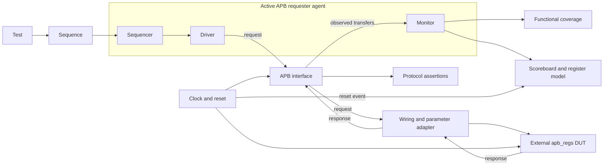

# APB4 UVM Verification

A verification project for the PULP `apb_regs` peripheral. The DUT and its
dependencies are third-party RTL; this repository is intended to contain the
UVM environment, reference model, assertions, coverage, and regression scripts.

**Status:** repository setup and DUT source compilation are complete. The UVM
environment, DUT integration, and functional tests are not implemented yet.
Architecture and test cases below describe the planned implementation.

## DUT and source provenance

| Component | Upstream | Pinned revision |
|---|---|---|
| APB4 register bank | [pulp-platform/apb](https://github.com/pulp-platform/apb) | `4821618d652cb2b219483f037395b902771a44dd` |
| Supporting RTL/macros | [pulp-platform/common_cells](https://github.com/pulp-platform/common_cells) | `46b3907d9ac97861ab5dee27d177b76530fdd038` (`v1.16.2`) |

The selected module is `apb_regs` in
[`third_party/apb/src/apb_regs.sv`](third_party/apb/src/apb_regs.sv).
The source files are vendored without modifications. Licenses, original
copyright notices, and SHA-256 hashes are retained under
[`third_party/`](third_party/README.md). No upstream testbench is presented as
verification work authored for this project.

## Baseline configuration

This is the configuration to be instantiated by the future testbench adapter.
It is not yet an elaborated or functionally verified design instance.

| Parameter/input | Value |
|---|---|
| `NoApbRegs` | 4 |
| `ApbAddrWidth` / `ApbDataWidth` / `RegDataWidth` | 32 / 32 / 32 bits |
| `AddrOffset` | 4 bytes |
| `ReadOnly` | `4'b1000` |
| `base_addr_i` | `32'h0000_0000`, constant |
| `reg_init_i[0]`, `[1]`, `[2]` | `32'h0000_0000` |
| `reg_init_i[3]` | `32'h4150_4234`, constant |
| Protocol | APB4, one requester and one peripheral |
| Transfers | Word-aligned; byte writes selected by `PSTRB` |
| Response latency | Zero wait states for this DUT |

## Signal interface

Directions are relative to `apb_regs`. APB request and response fields are packed
in `req_i` and `resp_o`; they are not separate top-level DUT ports.

### Clock, reset, and register-side ports

| DUT port | Direction | Baseline width | Description |
|---|---|---|---|
| `pclk_i` | Input | 1 | Clock; transfers are sampled on rising edges. |
| `preset_ni` | Input | 1 | Asynchronous, active-low reset. |
| `base_addr_i` | Input | 32 | Start address of the register bank. |
| `reg_init_i` | Input | 4 x 32 | Initialization-value input; RO registers expose the corresponding value directly. Baseline RW entries are zero. |
| `reg_q_o` | Output | 4 x 32 | Current register values; RO entries reflect `reg_init_i`. |

### APB request: `req_i`

| Field | Direction | Width | Description |
|---|---|---|---|
| `paddr` | Input | 32 | Byte address; baseline transfers use word-aligned addresses. |
| `psel` | Input | 1 | Selects this peripheral. |
| `penable` | Input | 1 | Marks the ACCESS phase. |
| `pwrite` | Input | 1 | `1`: write; `0`: read. |
| `pwdata` | Input | 32 | Write payload. |
| `pstrb` | Input | 4 | Byte enables; bit `i` selects `pwdata[8*i +: 8]`. Drive zero for reads. |
| `pprot` | Input | 3 | Protection attributes; unused by this DUT and held at zero in the baseline. |

### APB response: `resp_o`

| Field | Direction | Width | Description |
|---|---|---|---|
| `pready` | Output | 1 | Transfer completion qualifier. This RTL drives `psel & penable`. |
| `prdata` | Output | 32 | Read payload, checked on successful read completion. |
| `pslverr` | Output | 1 | Error response, sampled on transfer completion. |

### Transaction timing

1. **SETUP:** requester drives the address/control and asserts `PSEL`, with `PENABLE=0`.
2. **ACCESS:** requester asserts `PENABLE` and keeps the request stable while waiting.
3. **Completion:** monitor samples at a rising clock edge with reset inactive and
   `PSEL && PENABLE && PREADY` asserted.
4. The next transfer starts with a new SETUP phase. Back-to-back transfers to the
   same peripheral may keep `PSEL` high, but must deassert `PENABLE` for SETUP.

The agent must handle waits correctly, although this DUT does not generate them.
Wait-state agent tests require a separate response fixture or a different DUT;
they must not be counted as wait-state coverage of this register bank.

## Register map and checking contract

| Aligned address | Testbench name | Access | Expected value after reset |
|---|---|---|---|
| `0x00000000` | DATA0 | RW | `0x00000000` |
| `0x00000004` | DATA1 | RW | `0x00000000` |
| `0x00000008` | DATA2 | RW | `0x00000000` |
| `0x0000000C` | ID | RO | `0x41504234` |

These names and values are project configuration choices, not fixed names in
the generic upstream peripheral. Expected behavior is a verification contract,
not a claim that the current implementation has already passed these checks.

- Successful RW writes update selected bytes only. Unselected bytes retain
  their values; `PSTRB=0` is a no-op for a valid RW address.
- RO reads return the configured constant. RO writes return an error without
  changing data.
- Addresses outside `0x00..0x0F` return an error. The model does not update on
  an errored write and does not compare read payload on an errored read.
- Reset restores the expected RW values and cancels incomplete transactions.
- Unaligned accesses, changing register-side inputs at runtime, and protection
  enforcement are outside the initial scope.

## Verification architecture (planned)



| Component | Responsibility |
|---|---|
| Transaction/config | Represent requests, observed responses, and agent settings. |
| Sequence/sequencer | Generate scenarios and coordinate items sent to the driver. |
| Driver | Drive legal APB timing, handle reset, and enforce a configurable timeout. |
| Monitor | Reconstruct completed transactions from interface observations independently of the driver. |
| Scoreboard | Maintain an independent register model; check read data, responses, and transaction counts. |
| Coverage collector | Sample observed transfers and required scenarios. |
| Assertions | Check phase transitions and request stability at the interface. |
| Adapter/top | Connect clock/reset, parameters, and request/response structs; add no peripheral behavior. |

The model must not copy the DUT implementation or use intended driver traffic
as proof that a transfer completed. Reset handling must prevent aborted
transactions from being reported as completed transfers.

## Test plan

All tests are **planned**. No APB functional results or coverage percentages
have been produced. The first test will run in the actual APB environment;
there is no separate UVM-only smoke example.

| ID | Scenario | Primary checks | Scope |
|---|---|---|---|
| T01 | Reset and read all registers | Reset values and RO constant | Baseline |
| T02 | Write then read each RW register | Data correctness and address isolation | Baseline |
| T03 | Zero, all-one, alternating, walking-bit data | Data integrity | Baseline |
| T04 | Back-to-back RR/RW/WR/WW | Phase timing, order, transaction count | Baseline |
| T05 | Random idle gaps | No duplicated or lost transactions | Baseline |
| T06 | Out-of-map reads and writes | Error response; no unintended state changes | Baseline |
| T07 | Write RO, then read | Error response and unchanged value | Baseline |
| T08 | Reset during SETUP or ACCESS | Abort handling, reset values, recovery | Baseline |
| T09 | Full, partial, sparse, zero-byte write masks | Correct selected bytes and preservation of other bytes across successive writes | Baseline |
| T10 | Mixed legal random traffic across seeds | Model agreement, timeout, checked counts | After directed tests |
| T11 | One/multiple wait cycles | Driver stability and completion handling | Separate agent fixture; not baseline DUT coverage |
| T12 | Deliberate protocol/checker faults | Expected assertion or checker failure | Separate checker-validation suite |

### Assertions and functional coverage

- Assertions: SETUP-to-ACCESS progression, stable requests during waits,
  legal post-completion phase transitions, and known sampled controls/data.
- Coverage: direction, register/address region, access type, response, data
  patterns, byte masks, back-to-back direction pairs, and reset phase.
- Useful crosses: direction x region x response and RW register x byte mask.
  Exclude impossible combinations with documented reasons.
- Wait-state bins belong to a suitable fixture configuration; they are not
  reachable on the baseline zero-wait DUT.
- Assertions are scoped to this single-peripheral interface and reset contract.

### Completion criteria

- Required directed tests and the defined random regression pass.
- Expected transfers are actually observed and checked; zero-traffic runs cannot pass.
- No unexpected UVM errors/fatals, assertion failures, or timeouts remain.
- Every requirement maps to a checker/test; coverage gaps have documented dispositions.
- Failures are reproducible from source revision, simulator version, test name,
  seed, and run command. Deliberate injected faults are distinguished from DUT bugs.

## Repository layout

```text
third_party/       Pinned RTL subset, original licenses, and hash manifest
tb/agent/          Planned transaction, config, sequencer, driver, monitor, agent
tb/env/            Planned environment, scoreboard, and coverage collector
tb/sequences/      Planned stimulus scenarios
tb/tests/          Planned UVM tests
tb/top/            Planned interface, adapter, clock/reset, and top
tb/assertions/     Planned protocol assertions
sim/               DUT source list and compile script
scripts/           Vendor integrity checker
results/           Generated output, excluded from Git
```

## Validation status

On 2026-10-30, all 14 vendored files matched the pinned SHA-256 manifest, and
the five SystemVerilog source files in `sim/dut.f` compiled using Vivado 2024.2.
This validates source compilation only: parameterized elaboration, functional
simulation, UVM tests, and coverage remain outstanding. EDA Playground has not
been run for this repository.

## References

- [Arm AMBA APB protocol specification](https://developer.arm.com/documentation/ihi0024/latest/)
- [Pinned PULP APB source](https://github.com/pulp-platform/apb/tree/4821618d652cb2b219483f037395b902771a44dd)
- [Vendored source and licensing details](third_party/README.md)
